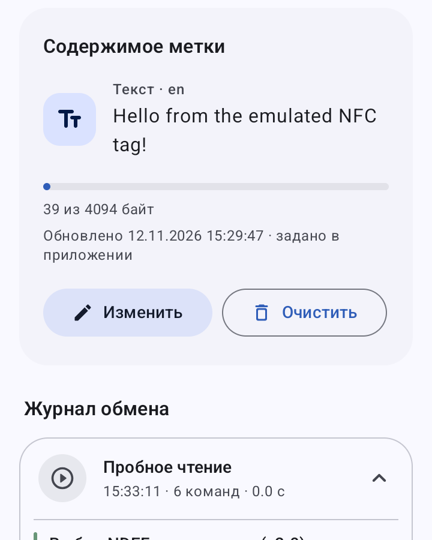
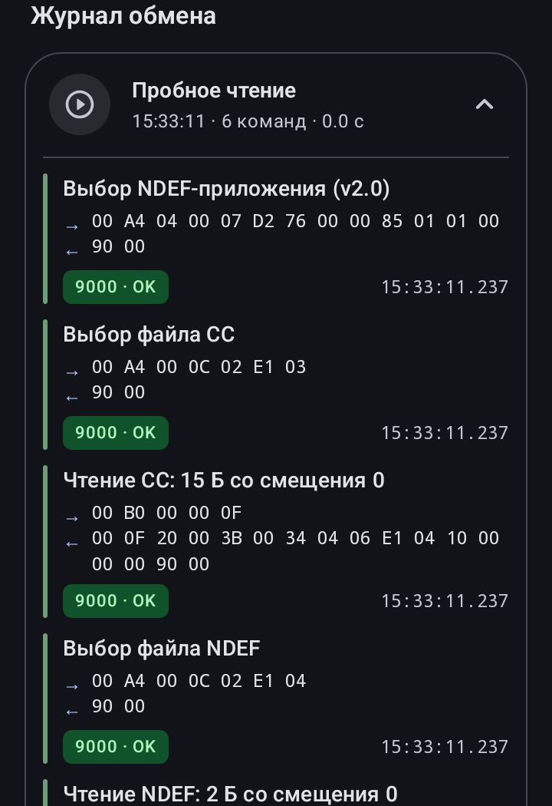

# NFC-метка

Android-приложение, которое превращает телефон в NFC-метку **NFC Forum Type 4** с NDEF-сообщением.
Метку можно прочитать и записать любым считывателем: iPhone (Core NFC), другим Android-телефоном
(например, NFC Tools) или USB-ридером.

<p>
  
  &nbsp;
  
</p>

## Возможности

- Эмуляция Type 4 Tag (Mapping 2.0, совместимо с 1.0) через Host Card Emulation. Работает и на заблокированном экране.
- Содержимое метки можно задать в приложении: текст или ссылка, до 4094 байт.
- Сообщения, которые записывает считыватель, принимаются и показываются. Содержимое сохраняется между запусками.
- Журнал обмена по сеансам: каждая команда APDU и ответ в hex, с расшифровкой и статусом.
- Пробное чтение встроенным считывателем показывает, что увидит настоящий ридер, даже без второго устройства.
- Журнал можно скопировать в буфер обмена.
- Светлая и тёмная тема.

## Как это работает

Считыватель общается с меткой командами APDU (ISO/IEC 7816-4). Android передаёт их в
`TagHostApduService`, если считыватель выбрал приложение NDEF.

| Шаг | Команда | Ответ |
|---|---|---|
| Выбор приложения NDEF | `00 A4 04 00 07 D2 76 00 00 85 01 01 00` | `90 00` |
| Выбор файла CC | `00 A4 00 0C 02 E1 03` | `90 00` |
| Чтение CC (параметры метки) | `00 B0 00 00 0F` | 15 байт + `90 00` |
| Выбор NDEF-файла | `00 A4 00 0C 02 E1 04` | `90 00` |
| Чтение длины (NLEN) и сообщения | `00 B0 <смещение> <длина>` | данные + `90 00` |
| Запись | `00 D6 <смещение> <длина> <данные>` | `90 00` |

Параметры из файла CC: чтение до 59 байт за команду, запись до 52 байт, NDEF-файл 4096 байт.

Запись идёт по спецификации: считыватель обнуляет NLEN, пишет данные и последним шагом записывает
настоящую длину. Сообщение считается принятым в этот момент. Если считыватель ушёл раньше, метка
остаётся пустой, как и настоящая.

## Требования

- Android 11 и новее (minSdk 30) с NFC и Host Card Emulation.
- NFC включён, экран включён (блокировка не мешает).

## Сборка

Нужны JDK 17 (входит в Android Studio) и Android SDK 35. Проект открывается в Android Studio Ladybug и новее.

```bash
./gradlew assembleDebug
```

Тесты логики метки (APDU, NDEF, Type 4 Tag) запускаются без устройства:

```bash
./gradlew testDebugUnitTest
```

## Структура

```
app/src/main/java/com/kurzyakov/nfctagemulation/
├── tag/    логика метки без зависимостей от Android: APDU, Type 4 Tag, NDEF, тестовый считыватель
├── data/   TagRepository: состояние метки, журнал сеансов, сохранение на диск
├── hce/    TagHostApduService — точка входа Host Card Emulation
└── ui/     Jetpack Compose: экран, карточки, редактор, тема
```

## Ограничения

- Android передаёт приложению только AID из `res/xml/apduservice.xml`: NDEF-приложения `D2760000850101` и `D2760000850100`.
- UID метки задать нельзя: при HCE он случайный и меняется. Считыватели, которые опознают метку по UID
  (например, системы доступа), её не узнают.
- Если на телефоне есть другое приложение с теми же AID, Android может спросить, какое использовать.
  Пока это приложение открыто, оно выбирается автоматически.
